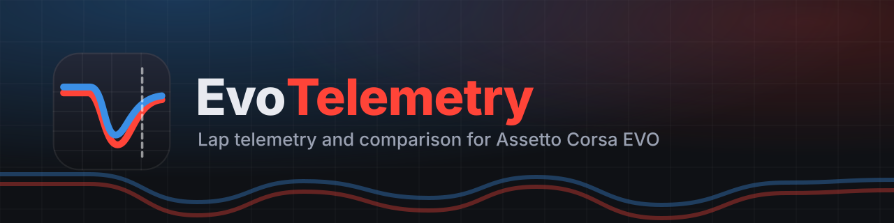
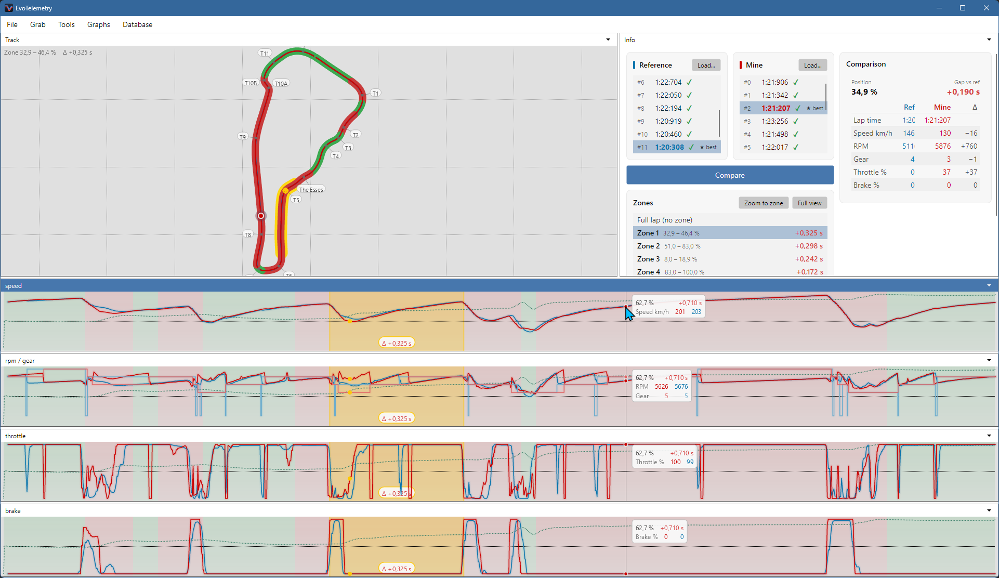

  

  <b>Record your laps in Assetto Corsa EVO, compare them with a reference and see exactly where you lose time.</b>

  
  &nbsp;
  

---

  

## Features

- **Live grab**: record laps straight from Assetto Corsa EVO, saved by hand or automatically.
- **Lap vs reference**: two laps aligned by track position, every channel side by side, with the time difference along the whole lap.
- **Zones**: the parts of the track where you lose or gain the most time, found for you and sorted by impact.
- **Reference laps**: a local database of laps to beat, ready to reuse.
- **Your layout**: dockable map, info and graph panels; every graph is configurable and the layout is remembered.
- **Light and dark theme**, track outlines, turn labels and satellite backgrounds.
- **One single `.exe`**: nothing to install.

## Download

1. Go to [**Releases**](../../releases/latest) and download `EvoTelemetry.exe`.
2. Put it in a folder of its own (for example `C:\Tools\EvoTelemetry\`). Settings are saved next to it, so avoid `Program Files`.
3. Run it.

**Requirements:** Windows 10 or 11, 64-bit. Assetto Corsa EVO is needed only to record laps.

> The first time, Windows SmartScreen may say *"Windows protected your PC"* because the file is not signed: click **More info → Run anyway**.

## Quick start

1. **Drive**: start Assetto Corsa EVO, open the **Grab** window in EvoTelemetry, do some laps and save them.
2. **Load**: in the **Info** panel, load a reference session (**Reference → Load...**) and yours (**Mine → Load...**). The best lap is marked ★, valid laps ✓.
3. **Compare**: pick one lap on each side and press **Compare**. Click any point of a graph or of the map to see both laps at that point.
4. **Find the time**: the **Zones** list shows where the time goes, red where you lose and green where you gain. Click a zone and **Zoom to zone** to study it.

## Documentation

Everything else is in the [**Wiki**](../../wiki):

| | |
|---|---|
| [Getting Started](../../wiki/Getting-Started) | From the first lap to the first comparison |
| [Grab Window](../../wiki/Grab-Window) | Recording laps from the game |
| [Analyze Window](../../wiki/Analyze-Window) | Map, graphs, info panel, docking, mouse controls |
| [Comparing Laps](../../wiki/Comparing-Laps) | Compare, zones, cursor, zoom |
| [Graphs and Channels](../../wiki/Graphs-and-Channels) | Customizing the graphs |
| [Reference Laps](../../wiki/Reference-Laps) | The reference lap database |
| [Track Backgrounds](../../wiki/Track-Backgrounds) | Outlines, satellite images, turn labels |
| [Settings Files](../../wiki/Settings-Files) | `graphs.json`, `grab.json`, `backgrounds.json` |
| [FAQ](../../wiki/FAQ) | Common questions and problems |

## Feedback

Found a bug or have an idea? Open an [**issue**](../../issues). For bugs, attaching the `.json.gz` file of the laps helps a lot.

---

EvoTelemetry is an independent tool, not affiliated with or endorsed by the publishers of Assetto Corsa EVO. Satellite imagery: USDA NAIP (public domain).